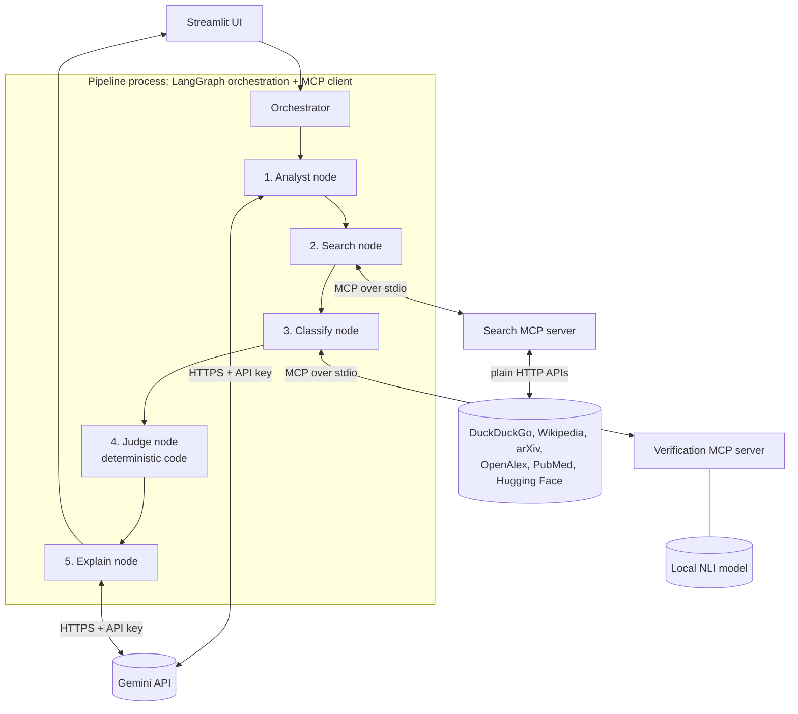

# Source-Based Fact-Checker

**An agentic, multi-source fact-checking pipeline built with the Model Context Protocol (MCP), LangGraph orchestration, Google Gemini and a local NLI model. It runs entirely on free tools.**

Enter a statement. The system plans a search strategy, queries many free sources in parallel, reads the retrieved text, classifies each source as **supporting**, **contradicting** or **unrelated**, weighs sources by trust, and returns a verdict with the exact quote and link behind every conclusion. The verdict is computed by deterministic code, not by the LLM.

> Verdicts describe what the retrieved sources say, not absolute truth. See [Limitations](#limitations).

---

## What it does, in plain words

Anyone can search the web and get links, but you still have to open each page, read it and decide who to believe. This project automates that reading-and-judging step:

1. It breaks your statement into small, separately checkable parts.
2. It searches for evidence **for** each part and evidence **against** it.
3. It reads the sources and labels each one: supports, contradicts or unrelated.
4. It trusts official sources (research papers, government sites) more than random websites.
5. It gives a verdict, or honestly says **"Not enough evidence"** when it can't decide.

---

## Architecture



The pipeline is the **only MCP client**. The two MCP servers never communicate with each other: the pipeline carries the retrieved sources from the Search server to the Verification server. MCP is used only between the pipeline and the servers. The Search server reaches external data sources with ordinary HTTP requests, and Gemini is called directly over its API.

### Components

| Component | Technology | Role |
|---|---|---|
| Orchestration | **LangGraph** (async state graph) | Runs the five stages, passes shared state between agents |
| Agent communication | **Model Context Protocol (MCP)**, `FastMCP`, stdio transport | Two independent servers expose tools to the agents through a standard client/server protocol |
| LLM | **Google Gemini API** (free tier) | Plans searches (structured JSON output) and writes the final explanation |
| Evidence classification | **NLI** (Natural Language Inference) cross-encoder, DeBERTa-v3, run locally via `sentence-transformers` | Decides if a passage entails or contradicts a statement |
| Retrieval | `ddgs`, Wikipedia API, arXiv API, OpenAlex, PubMed E-utilities, Hugging Face Hub, `trafilatura` | Gathers sources; `asyncio` + thread pools for parallel retrieval |
| Verdict logic | Plain Python (`judge.py`) | Trust-weighted scoring, de-duplication, final verdict |
| Interface | **Streamlit** | Input, live stage log, evidence viewer, Markdown report export |
| Caching | SQLite | Repeat statements return instantly |

---

## The pipeline in detail

**1. Analyst agent.** Gemini reads the statement and decides how many separate factual assertions it contains (one part per assertion, capped by `MAX_PARTS`). For each part it writes a query likely to find supporting evidence and a query likely to find contradicting evidence, and it selects which source types are relevant (for example PubMed for health claims, Hugging Face for AI-model claims). Output is structured JSON, validated in code. If the LLM fails, a basic plan is used so retrieval still runs.

**2. Search agent (Search MCP server).** Tool calls run concurrently under a semaphore to respect rate limits. Results are de-duplicated by URL and ranked by relevance plus trust. The top web results are upgraded from snippets to full-page text with `trafilatura`. Every retrieved source is stored by ID and readable through an MCP resource (`source://{id}`).

**3. Verification agent (Verification MCP server).** For each part, the server selects the most relevant passages from each source by key-word overlap, then runs the local NLI model on (passage, statement) pairs. A figure-matching check normalises numbers (`1M` equals `1,000,000`) and flags same-topic passages with a different figure, such as `$0.05` versus `$0.50`. Each source becomes `supports`, `contradicts` or `unrelated` with a confidence score and a verbatim quote.

**4. Judge (deterministic code).** Sources are tiered by trust and weighted:

| Tier | Examples | Weight |
|---|---|---|
| 1 Primary / official | arXiv, PubMed, `.gov`, `.edu`, WHO, Nature | 3 |
| 2 Reputable | Wikipedia, major news, fact-checking organisations | 2 |
| 3 General web | everything else | 1 |

A verdict needs a total weight of at least 3 **and** at least one tier 1 or 2 source, so low-trust pages can never decide on their own. Repeated copies of one passage and many pages from the same site are counted once or twice. Possible verdicts: `SUPPORTED`, `CONTRADICTED`, `MIXED`, `PARTIALLY_SUPPORTED`, `NOT_ENOUGH_EVIDENCE`, `ERROR`.

**5. Explainer.** Gemini writes a short explanation constrained to the collected evidence. It cannot change the verdict. If the LLM is unavailable, a template is used.

### Design principles

- **The LLM never decides the verdict.** It plans and explains; code judges.
- **Fail closed.** No reliable evidence means "Not enough evidence", never a guess.
- **Transparent.** Every verdict shows quotes, links, trust tiers, confidence and the method used.
- **Graceful degradation.** Retries, timeouts and a model fallback chain keep a single API failure from breaking a run.
- **Free tools only.** No paid APIs.

---

## Project structure

```
factcheck/
├── app.py              # Streamlit UI
├── graph.py            # LangGraph pipeline: analyst, search, classify, judge, explain
├── pipeline.py         # Starts MCP servers, runs the graph, streams stage updates
├── mcp_client.py       # MCP client: launches both servers over stdio
├── search_server.py    # MCP server 1: search tools + source store/resource
├── verify_server.py    # MCP server 2: NLI evidence classification tool
├── sources.py          # Free source connectors (plain Python functions)
├── verifier.py         # Passage selection, NLI, figure matching
├── judge.py            # Trust-weighted verdict logic + Markdown report
├── trust.py            # Domain -> trust tier
├── textutil.py         # Tokenising / keyword overlap helpers
├── llm.py              # Gemini wrapper: retry, backoff, timeout, fallback chain
├── cache.py            # SQLite cache
├── config.py           # All settings (env-overridable)
├── test_logic.py       # Unit tests (no network, no models, no API key)
├── check_mcp.py        # Smoke test: starts MCP servers, tests each source
└── requirements.txt
```

---

## Setup

**Requirements:** Python 3.11 or 3.12 recommended, a free Gemini API key from [Google AI Studio](https://aistudio.google.com/).

```bash
git clone https://github.com/<your-username>/<repo-name>.git
cd <repo-name>
python -m venv venv
source venv/bin/activate            # Windows: venv\Scripts\activate
pip install -r requirements.txt

export GEMINI_API_KEY="your_key"    # Windows PowerShell: $env:GEMINI_API_KEY="your_key"

python test_logic.py                # unit tests, no network needed
python check_mcp.py                 # starts both MCP servers, tests each free source
python -m streamlit run app.py
```

The first verification run downloads the NLI model (about 700 MB). For a lighter model, set `NLI_MODEL=cross-encoder/nli-MiniLM2-L6-H768`.

### Configuration

| Variable | Purpose | Required |
|---|---|---|
| `GEMINI_API_KEY` | Gemini API key (free tier) | Yes |
| `PRIMARY_MODEL`, `FALLBACK_MODELS` | Gemini model names (check Google AI Studio for current names) | No |
| `GROQ_API_KEY` | Adds Groq as a last-resort fallback LLM | No |
| `GOOGLE_FACTCHECK_API_KEY` | Free key for the Google Fact Check Tools API | No |
| `CONTACT_EMAIL` | Polite-use identification for OpenAlex / PubMed | No |
| `MAX_PARTS` | Max parts a statement is split into (default 6) | No |
| `NLI_MODEL` | Local NLI model | No |

Never commit API keys. They are read from environment variables, and `.env` is git-ignored.

---

## Example test statements

| Statement | What it exercises |
|---|---|
| The Great Wall of China is visible from space with the naked eye. | Myth debunking |
| The Eiffel Tower is in Paris, was completed in 1889, and is taller than the Empire State Building. | Multi-part splitting |
| The Zorblax-9 language model costs $0.05 per million tokens. | Refusing to guess (made-up entity) |
| GPT-3 has 175 million parameters. | Figure mismatch detection |

---

## Limitations

- **Sources, not truth.** A verdict reflects retrieved sources. A widely repeated error can mislead the system.
- **NLI weaknesses.** NLI models are weaker on numbers, negation and long multi-clause sentences. The figure-matching heuristic helps but can misfire when two different things share a topic.
- **Free-tier constraints.** Search APIs are rate-limited and incomplete, so "Not enough evidence" is a common and often correct result.
- **Context-dependent statements.** Statements missing a place, time or referent (for example "it rained in my city yesterday") cannot be checked as written.
- **Language.** Tuned for English statements and sources.
- **No MCP authentication.** Servers run locally over stdio and are not designed for public deployment as-is.

## Roadmap

- Clarification step that asks for missing context (location, date) before searching
- Article scanner: extract and verify every checkable statement in a pasted text
- Structured-data lookups (weather, population) through additional MCP tools
- Per-claim streaming of results in the UI

## License

Add a license of your choice (for example MIT) before publishing.
